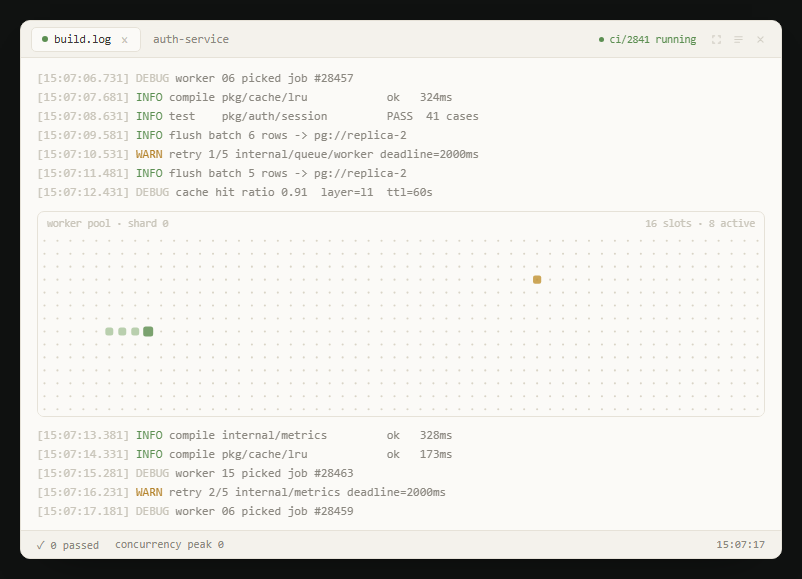

# dsh-moyu

A side panel for DeepSeek Harness that renders a fake CI build log. The `worker pool` grid in the middle of it is a snake game.



## What it does

`▤ log` sits to the right of the composer and opens a panel shaped like a build log: a tab bar, streaming lines above and below, a `worker pool · shard 0` grid, and a status bar. The whole thing is a 56×14 game board. Green blocks are busy workers, the amber block is a queued job; eating one advances `✓ N passed`, and every five jobs the concurrency count and the step rate go up. A wall or your own tail turns the tab red — `ci/2841 failed` — and the run restarts after about a second.

Three views:

| View | How to reach it | What changes |
| --- | --- | --- |
| full | default | logs above and below the grid |
| compact | `Ctrl+Alt+L` or the size icon | logs dropped, grid only, panel narrows to 560px |
| camouflage | `Ctrl+Alt+H` or the lines icon | grid replaced by one continuous log stream |

## Install

Once listed in the market: open dsh-market, search `dsh-moyu`, install.

From the prebuilt release package:

```sh
dsh plugin --profile <profile> add https://github.com/easonandkhalil/dsh-moyu/releases/download/v0.1.0/dsh-moyu-0.1.0.tgz
```

From GitHub:

```sh
dsh plugin --profile <profile> add github:easonandkhalil/dsh-moyu
```

From a checkout:

```sh
dsh plugin --profile <profile> add ./path/to/dsh-moyu
```

Restart the web UI afterwards. The `▤ log` button appears beside the composer, and the panel can also be opened with `Ctrl+Alt+M`.

## Controls

| Key | Action |
| --- | --- |
| `←` `↑` `↓` `→` or `WASD` | steer |
| `Ctrl+Alt+M` | open / close the panel |
| `Ctrl+Alt+L` | full ↔ compact |
| `Ctrl+Alt+H` | camouflage on / off |

Drag the tab bar to move the panel; `×` on the tab or the icon at the right end closes it. Position and view mode persist in `localStorage['dsh.moyu.box']`, best score in `localStorage['dsh.moyu.best']`.

The board freezes while the window does not have focus, and while the caret is in a text field — switching to a real task, or typing a prompt, does not cost you a run. The log lines keep streaming in the background either way.

## Notes

- Web client only (`dsh.client.platform` is `web`).
- The panel is a viewport-fixed overlay with a high z-index. It is meant to sit on top of the conversation; drag it aside if it covers something.
- No network requests, no telemetry, no audio, no dependencies. Everything lives in `client.js`, which the host loads as-is — there is no build step.
- `Esc` is deliberately not bound: the host already uses it.

## Files

```
client.js           styles, fake log, game loop, slot registrations — the whole plugin
index.js            host half; apply() is empty because everything is client-side
cordis.patch.yml    one insert entry, id dsh-moyu
screenshots.json    storefront screenshots
assets/             icon and screenshots
```

## License

MIT

## 中文说明

一块伪装成 CI 构建日志的侧边面板，中间那条 `worker pool · shard 0` 网格就是贪吃蛇。

- 输入框右侧的 `▤ log` 打开面板，或按 `Ctrl+Alt+M`；按在标题栏上可以拖动，点 `×` 关闭。
- 方向键 / `WASD` 转向。绿色方块是正在跑的 worker，琥珀色是排队任务；吃掉一个，状态栏的 `✓ N passed` 加一，每五个并发数和速度各提一档。撞墙或撞到自己，标签页变红显示 `ci/2841 failed`，约一秒后自动重开。
- `Ctrl+Alt+L` 在「带日志」和「只有蛇盘」两档之间切换；`Ctrl+Alt+H` 伪装成整屏日志。
- 窗口失焦、或光标停在输入框里时，蛇会停住不动，日志照常滚动 —— 切去干活不会白白送掉一局。
- 位置和档位存在 `localStorage['dsh.moyu.box']`，最高分存在 `localStorage['dsh.moyu.best']`。没有网络请求，没有埋点，没有声音。

安装：收录后可在 dsh-market 里搜 `dsh-moyu`；也可执行 `dsh plugin --profile <profile> add github:easonandkhalil/dsh-moyu`，然后重启 Web 界面。预构建安装包见本仓库的 v0.1.0 Release。
